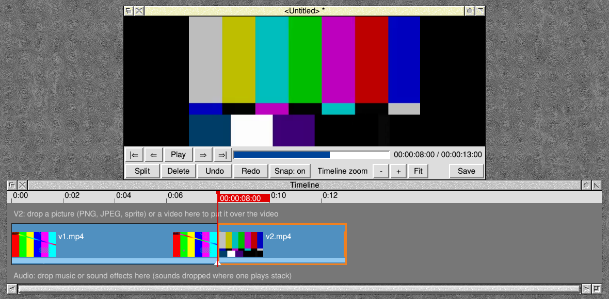
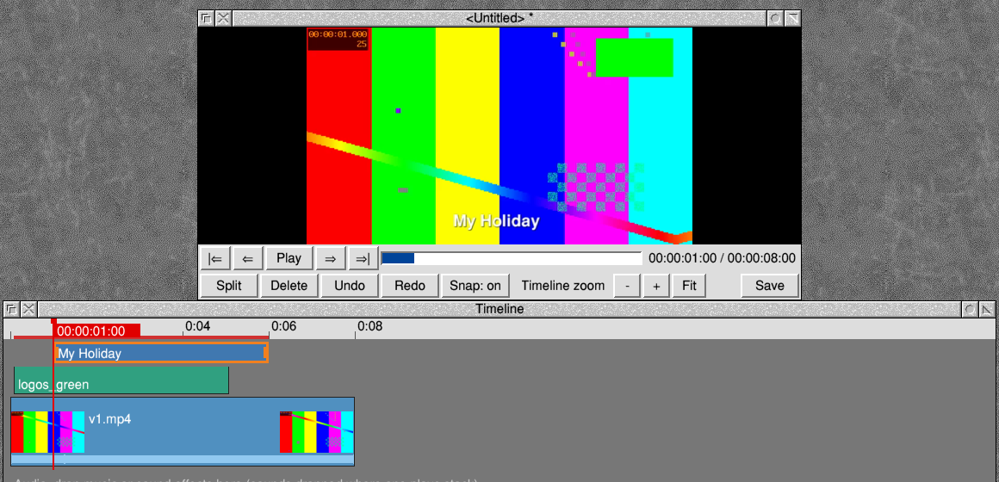
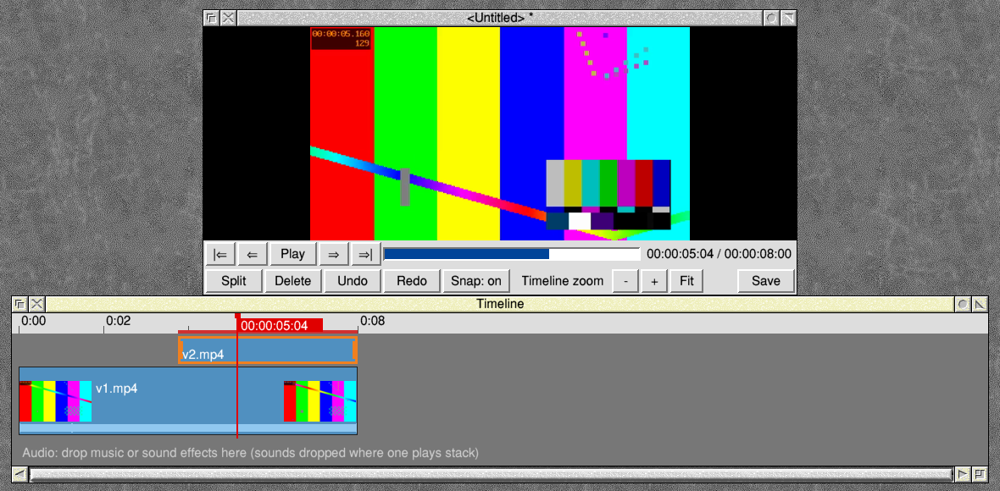
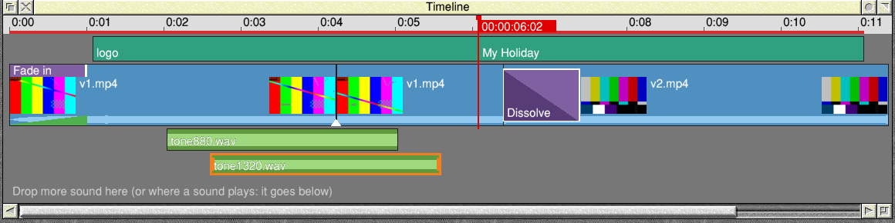
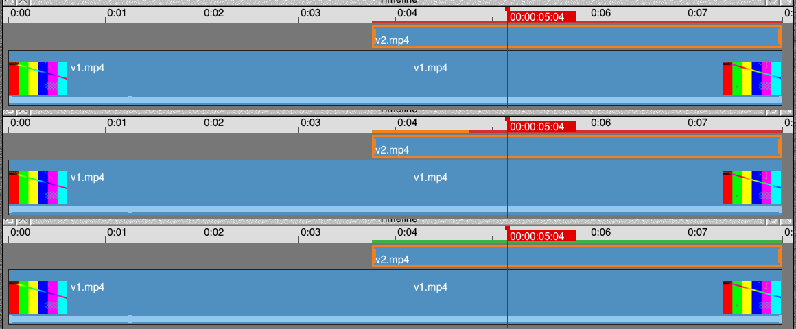
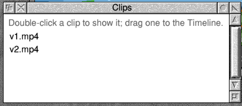
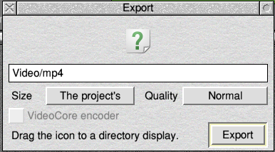

# riscos-reeledit

ReelEdit: a non-linear video editor for RISC OS. Its engine is the
[MLT multimedia framework](https://www.mltframework.org) (the engine of
Shotcut and Kdenlive), patched to run on RISC OS without threads, with the
Raspberry Pi's video hardware through
[riscos-reelhwaccel](https://github.com/adyoull/riscos-reelhwaccel) and
FFmpeg from [riscos-ffmpeg](https://github.com/adyoull/riscos-ffmpeg).

**ReelEdit 0.3 Beta** is ready for testing on RISC OS 5 (Raspberry Pi 2, 3
and 4). Download it from
[Releases](https://github.com/adyoull/riscos-reeledit/releases). It comes
with an illustrated User Guide (in the zip, and in [docs/guide](docs/guide)
here): press F1 in the editor, or choose User guide from the icon bar menu.



## What it does

- Cut, trim, move, split and roll clips; marks, extract and lift; copy and
  paste; 100 levels of undo
- Fades and dissolves
- Each clip's sound muted, faded or set louder or quieter, and music and
  sound effects on audio tracks that stack as you add them
- Logos, pictures and picture in picture on an overlay track (V2)
- Titles in RISC OS fonts, on their own track, so a title can go over a
  logo or a picture in picture
- Slow motion, fast motion and reverse
- A Clips window with three-point editing (insert and overwrite)
- Render previews and automatic proxies for smooth playback of busy
  projects and HEVC
- Autosave with crash recovery
- Export to MP4 (H.264 and AAC), with the Pi's VideoCore encoder
- Logging (off as standard; on from the icon bar menu) for bug reports

| | |
|---|---|
|  |  |
| A title on its own track, over a logo on V2 | Picture in picture |
|  |  |
| Sounds stacking on audio tracks | Render previews: red, rendering, rendered |
|  |  |
| The Clips window | Exporting to MP4 |

**Needs:** RISC OS 5 on ARMv7 with VFP (Raspberry Pi 2, 3, 4);
SharedUnixLibrary 1.16 or later and ARMEABISupport (PackMan);
SharedSoundBuffer and StreamManager for sound; `gpu_mem=128` in
`config.txt` for 1080p.

**Reporting a problem:** choose Logging from the icon bar menu, do it
again, and attach `<Wimp$ScrapDir>.ReelEditLog` to an
[issue](https://github.com/adyoull/riscos-reeledit/issues).

## What's here

| Path | What |
|---|---|
| `patches/mlt/` | Patches to MLT 7.42.0 (see [PORTING.md](docs/PORTING.md)): static modules (no dlopen), no threads, the avformat module without threads, preferred (hardware) decoders with a fallback, no needless picture conversions, and faster compositing, scaling and fades (NEON) |
| `build/` | Fetching the sources, the RISC OS build, the Linux build for the tests, the `!MLT` zip |
| `src/engine.c` | ReelEdit's player: a project played from Wimp null events, a picture at a time |
| `src/project.c` | The editing model (MLT's tractor and playlists): add, split, remove, save, open |
| `src/riscos/` | The desktop program, `!ReelEdit`: the Viewer, the Timeline, menus and windows, render previews, proxies, autosave, logging, sound |
| `app/!ReelEdit/` | The application's files (`build/package-reeledit.sh` makes the zip) |
| `app/!MLT/` | The engine test application: `*melt`, `*mltbench` (`tools/bench.c`), and `Test`, which tries MLT on the machine |
| `tests/host/` | Linux tests |
| `docs/` | [guide/](docs/guide): the User Guide; [DESIGN.md](docs/DESIGN.md): the editor; [PORTING.md](docs/PORTING.md): what was changed for RISC OS and why |

## Building

Needs x86-64 Linux with [riscos-crossdev](https://github.com/adyoull/riscos-crossdev)
(v1.8.2, `make prebuilt`), cmake, pkg-config and python3; for the tests,
gcc, libxml2's headers and the `ffmpeg` command (with libx264).

```sh
export RCD_DIR=/path/to/riscos-crossdev
build/fetch-sources.sh        # MLT, libxml2, the riscos-ffmpeg and riscos-mesa devkits, FFmpeg 5.1.10
build/build-riscos.sh         # libxml2 and MLT for RISC OS; melt,ff8, checked
build/build-host.sh           # the same MLT for Linux, for the tests
tests/host/run.sh             # must end "== all passed"
VERSION=7.42.0-riscos1-test1 build/package.sh   # out/MLT-<VERSION>.zip
```

In riscos-crossdev's container image, `RCD_DIR` is `/opt/riscos-crossdev`.

## The tests

`tests/host/run.sh` builds MLT as it is built for RISC OS (static, no
threads, the same preferred decoders) and checks:

- **melt** saves a two-clip crossfade as MLT XML and renders it, with no
  thread started (counted with an `LD_PRELOAD` wrapper), reporting progress;
  with `MLT_NO_THREADS=0` it uses threads again.
- **pull_test** plays the project as ReelEdit does, a frame at a time from
  the program's own loop: the right pictures in any order, the dissolve the
  same in yuv420p as in yuv422, and no threads.
- **render_test**: a started consumer renders every frame's picture and
  sound with no threads (the null consumer rendered nothing before).
- **convert_test** counts swscale calls: none when pictures are asked for in
  their own format and size, through a dissolve, in an export, and for a
  colour in an HD profile (which must be BT.709).
- **engine_test** runs `src/engine.c` against a clock the test controls:
  every frame on a fast machine, keeping to the clock on a slow one with the
  sound unbroken, catching up after a stall, seeks that replace each other,
  stopping at the end, backwards at double speed, half-size preview.
- **project_test**: the editing model: the first clip's profile; adding
  at the end or at a frame; splitting; removing (ripple, gap); saving as
  MLT XML and opening it again; files that aren't projects refused; the
  engine showing each edit.
- **editor_test** runs `!ReelEdit` against a scripted fake Wimp: the icon
  opens the editor; clips dropped on the Timeline (where dropped) and the
  Viewer; playing through the overlay with the sound as the clock; ruler
  clicks, S, selecting and Delete; the menu; saving by a typed name and by
  dragging the file icon (the DataSave protocol); closing with changes
  (Cancel, Discard); a saved project (type XML, no extension) opened
  again; a desktop shutdown (PreQuit, Discard, the shutdown restarted).
- **prefer_test** stands in for the Pi's H.264 decoder: used when it works,
  replaced by the ARM decoder when it refuses a clip at the start or part
  way, given `drop_before` after each jump, never asked for when
  `MLT_AVFORMAT_PREFER` is empty, opened only when the first picture is
  decoded, and limited by `MLT_AVFORMAT_PREFER_MAX`.

Each test was mutation-checked: breaking the code it covers makes it fail.

## Licence

The patches to MLT are under MLT's licences (LGPL 2.1 or later for the
framework and the modules used). ReelEdit's own code is GPL version 2 or
later. Built with riscos-ffmpeg's FFmpeg (GPL with the hardware decoders),
the programs as a whole are GPL version 2.

